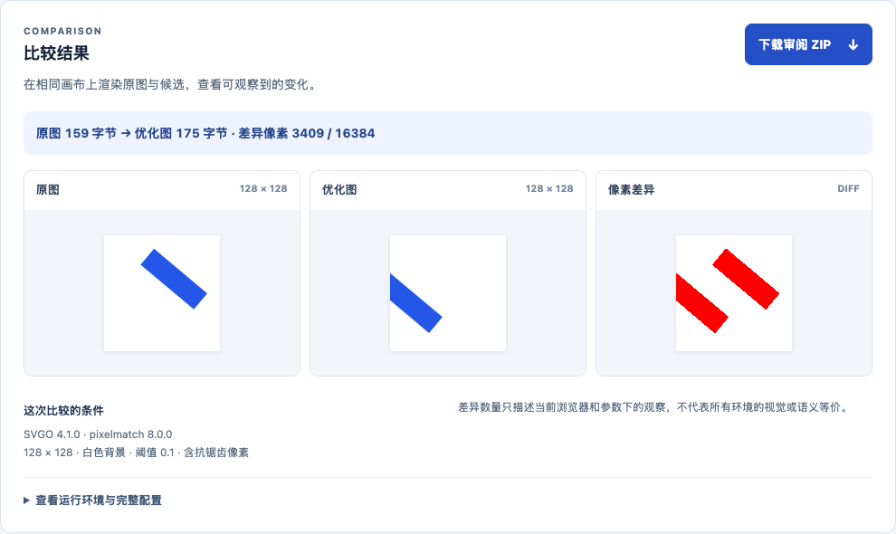

# SVG Review Pack

A browser-local, single-SVG review tool: optimize with pinned SVGO, compare the rendered pixels, and export a review pack that another person can rerun. It is not an official SVGO project.

**[Try the live demo](https://fightjs.github.io/svg-review-pack/)** · **[Source repository](https://github.com/FightJs/svg-review-pack)** · **Interface:** Simplified Chinese



The original example above was measured with SVGO 4.1.0 and pixelmatch 8.0.0 in the recorded browser. The count is specific to its rendering conditions; it is not a general equivalence verdict.

There is no analytics or upload endpoint. The page processes files in the browser; the local server serves application assets and does not receive the selected SVG.

## Run locally

Requirements: Node.js 20.13 or later and npm. Tested with Node 20.13.0 and npm 10.8.0 on macOS. The initial dependency installation normally needs network access.

```sh
npm ci --ignore-scripts
npm run dev
```

Open the localhost address printed by Vite. For a production build, run `npm run build` and `npm run preview`; open its localhost address. Serve `dist/` over HTTP(S): opening its HTML directly as `file://` does not reliably support module workers. The page loads an original example automatically. Select or drop one file, edit the limited JSON, and select **优化并比较**. Changing either input invalidates the old result. **恢复示例** resets and runs the example. **下载审阅 ZIP** becomes available only after optimization and both renders succeed.

## Reproduce the example and verify a pack

The example is a hand-written blue path using `transform-origin` and rotation, inspired by the type of issue discussed in [SVGO #2320](https://github.com/svg/svgo/issues/2320), not copied from its assets. On the tested browser, default settings produced 159 → 175 UTF-8 bytes and **3,409 different pixels**; another browser or version may render differently. The page calculates the count. [The example ZIP](evidence/example-review-pack.zip) was generated by the production build.

Unzip a downloaded pack into a new directory, then run:

```sh
npm ci --ignore-scripts
node verify.mjs
```

The script checks the installed `svgo` version, three SHA-256 hashes, complete allowed configuration, and exact UTF-8 bytes of a fresh optimization. It exits nonzero on a mismatch, missing file or dependency, invalid config, or execution error. The ZIP contains the same complete `package-lock.json` as the application build, including development dependencies; installing normally needs the network. `report.html` is a self-contained **offline viewing** report, not a verifier. Hashes are not signatures: a pack and its hashes can be replaced together, so they do not establish authorship, provenance, safety, or visual/semantic equivalence.

## Supported input

Input is at most 65,536 bytes of strictly decoded UTF-8 without BOM, valid XML, one SVG namespace root with a valid finite positive-size `viewBox`, at most 300 elements and depth 20 (root is depth 1), and at most 8,192 characters in each `d` attribute. Input bytes are retained exactly. XML comments and whitespace-only text are allowed. Other text and processing instructions, DOCTYPE and entity declarations are rejected. Both original and optimized SVG are validated; unsupported optimizer output stops export. There is no silent cleanup.

| Element | Element-specific attributes |
| --- | --- |
| root `svg` | `xmlns`, `viewBox`, `width`, `height` |
| `g` | none |
| `path` | `d` |
| `rect` | `x`, `y`, `width`, `height`, `rx`, `ry` |
| `circle` | `cx`, `cy`, `r` |
| `ellipse` | `cx`, `cy`, `rx`, `ry` |
| `line` | `x1`, `y1`, `x2`, `y2` |
| `polyline`, `polygon` | `points` |

All these elements may also use `fill`, `fill-opacity`, `fill-rule`, `stroke`, `stroke-width`, `stroke-opacity`, `stroke-linecap`, `stroke-linejoin`, `stroke-miterlimit`, `stroke-dasharray`, `stroke-dashoffset`, `opacity`, `transform`, and `transform-origin`. Numeric geometry and opacity values are finite unitless numbers; path, points, transform and paint values have conservative syntax checks. Paint values allow hex or identifier tokens (the browser may ignore an unrecognized color identifier). Unknown attributes and namespaces are rejected. There is no nested SVG, CSS/style, script, events, text/font, image, `use`, animation, URLs, gradients, filters, external reference, arbitrary plugin, or general SVG support. The render copy is given a 128 × 128 viewport with `xMidYMid meet` to fit the `viewBox` on white; the saved original bytes are not rewritten.

The JSON field accepts only `floatPrecision` (integer 0–6, default 3) and `multipass` (boolean, default false). The saved complete config fixes `path` to `input.svg`, `plugins` to `["preset-default"]`, and `js2svg` to `{ "eol": "lf", "pretty": false }`. No config file or user JS is loaded. An optimizer worker has a 10-second timeout; it is not a security sandbox.

Canvas dimensions are 128 × 128 **physical pixels**, on white, independent of device pixel ratio. `pixelmatch@8.0.0` uses `threshold: 0.1` and `includeAA: true`. Zero means no differences detected under those conditions; it is not proof for other browsers, sizes, backgrounds, or SVG semantics.

## Development and verification

```sh
npm run typecheck
npm test
npm run build
node tests/verify-export.mjs
```

The last command tests the checked-in example ZIP with a fresh temporary installation and deliberate mutations. Browser tests are in `tests/`, the browser/Node entry-point gate is in `gate/`, and actual results, environment, commands and remaining gaps are in [VERIFICATION.md](VERIFICATION.md). Entry-point agreement for a small sample is not a guarantee for all inputs; every exported pack must still be independently rerun.

## Third-party licenses

This project is licensed under the [MIT License](LICENSE). Third-party packages retain their own licenses: SVGO 4.1.0 (MIT), pixelmatch 8.0.0 (ISC), JSZip 3.10.1 (MIT **or** GPL-3.0-or-later), Vite 6.4.1 (MIT), and TypeScript 5.9.3 (Apache-2.0). See [THIRD_PARTY_NOTICES.md](THIRD_PARTY_NOTICES.md) for collected notices and the boolbase 1.0.0 notice caveat. Transitive dependencies and license notices are also available in the installed packages; exact versions and integrity hashes are in `package-lock.json`.
