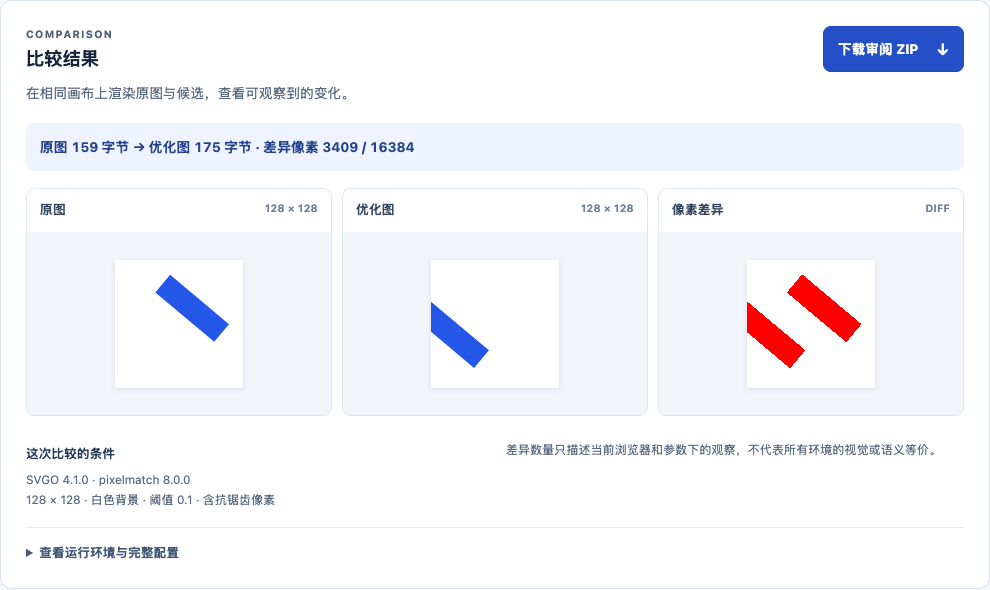

# SVGO 4.1 实测：用 128×128 像素差异审阅 transform-origin 图形

> 草稿，未发布。本文由 AI 协助整理；案例、结果和截图来自本地实际运行。源码仓库与在线 Demo 尚未发布，发布前须替换为实际验证过的地址。
>
> GitHub 源码：**待仓库创建并核实**  
> 在线 Demo：**未部署**。本地运行：在项目目录执行 `npm ci --ignore-scripts`，再执行 `npm run dev`。

同一个 SVG，优化前后都能被浏览器渲染，并不意味着在每种情况下都会得到相同画面。下面是一个为审阅编写的小例子：蓝色路径同时使用旋转和 `transform-origin`。在一次本地测试中，SVGO 4.1.0 生成的候选图与原图，在固定浏览器、128×128 白底和指定像素差算法下有 **3,409 个不同像素**。原文件 159 字节，候选 175 字节；优化结果并不一定更小。



截图为真实程序运行结果，不是人工重绘。环境为 macOS 上的 HeadlessChrome/157.0.0.0；算法为 pixelmatch 8.0.0，`threshold: 0.1`、`includeAA: true`。这不是所有浏览器、尺寸或背景下的结论，也不能据此断言所有 SVG 语义是否等价。

## 一个可重跑的输入

保存以下内容为 `input.svg`（UTF-8，无 BOM；不要在文件末尾添加换行，以便与上述字节数一致）：

```svg
<svg xmlns="http://www.w3.org/2000/svg" viewBox="0 0 100 100"><path fill="#2456e8" transform="rotate(40)" transform-origin="50 50" d="M20 25h60v18H20z"/></svg>
```

在 SVG Review Pack 项目目录运行 `npm ci --ignore-scripts` 后，把该文件放在同一目录，执行下面的 Node 命令。它使用项目锁定依赖、固定路径、preset 和 LF 输出；这里的 Node 输出是优化结果，不会单独计算浏览器像素。

```sh
node --input-type=module <<'JS'
import { readFileSync, writeFileSync } from 'node:fs';
import { optimize } from 'svgo';
const input = readFileSync('input.svg', 'utf8');
const config = {
  path: 'input.svg',
  plugins: ['preset-default'],
  floatPrecision: 3,
  multipass: false,
  js2svg: { eol: 'lf', pretty: false }
};
const output = optimize(input, config).data;
writeFileSync('optimized.svg', output, 'utf8');
console.log(output);
JS
```

在本次锁定版本测试中，候选路径变为：

```svg
<svg xmlns="http://www.w3.org/2000/svg" viewBox="0 0 100 100"><path fill="#2456e8" d="m-.749 32.007 45.963 38.567-11.57 13.789-45.963-38.567z" transform-origin="50 50"/></svg>
```

SVGO 输出不同不必然意味着存在视觉问题，因此本例还用同一浏览器分别渲染输入和候选，观察画面差异。示例由我们独立编写，受 [SVGO #2320](https://github.com/svg/svgo/issues/2320) 讨论的变换问题启发；这不是对该 issue 的完整复现，也不声称修复了 SVGO。

## 审阅包怎样复核

页面中的 **下载审阅 ZIP** 包含原始 `input.svg`、完整有效配置、`optimized.svg`、三张 PNG、自包含离线报告、锁文件和 `verify.mjs`。解压后运行：

```sh
npm ci --ignore-scripts
node verify.mjs
```

复验脚本核对文件哈希、SVGO 精确版本与配置，并重新优化、逐字节比较结果。故意修改输入、配置、候选或版本时，本地测试返回非零；把候选和它的哈希一起修改也会因重新优化结果不同而失败。报告可离线查看，但首次安装依赖通常需要联网。哈希不是签名：如果整个包被替换，它不能证明作者或文件来源。

首版只接收一份不超过 64 KiB 的受限 SVG：简单几何、有限属性、有效 `viewBox`；脚本、样式、外链、文本、滤镜和未知属性会被拒绝。它不是任意 SVG 的通用安全清理器。像素数只回答“在这次浏览器、画布和阈值下观察到了什么”，并不证明其他环境都一样。

审阅 SVG 优化 PR 时，可以依次确认：原始字节和配置是否随包保存；同版本重跑是否通过；不同浏览器或实际目标尺寸是否需要另外渲染；差异是否符合图标用途。源码和 Demo 发布后应在文首补上真实可访问的链接。
